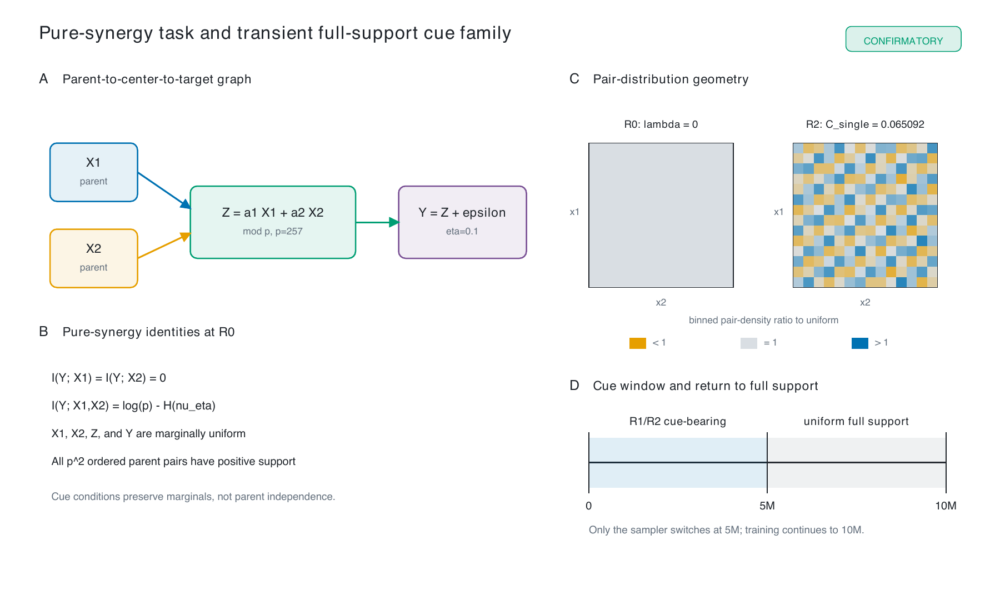
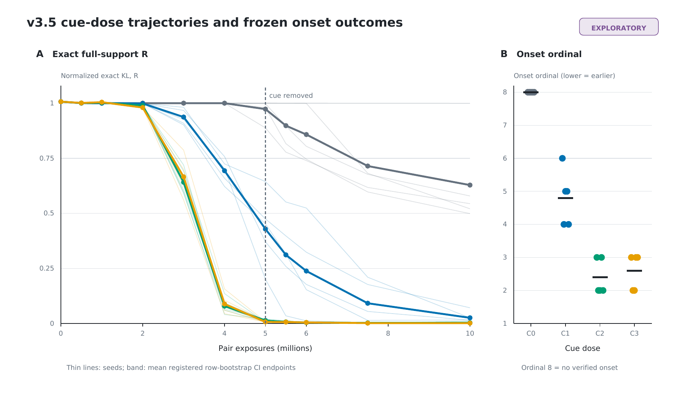
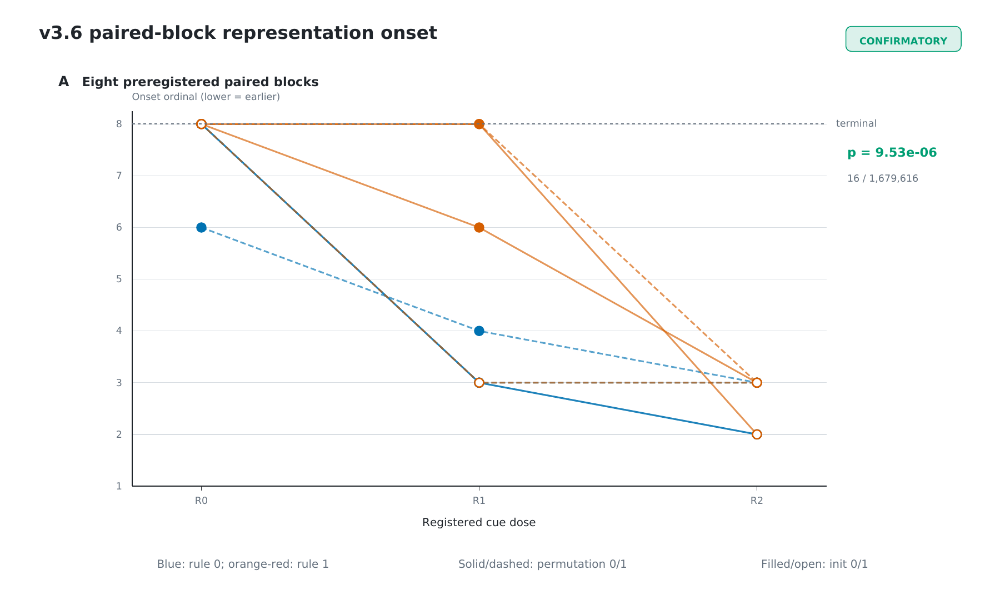
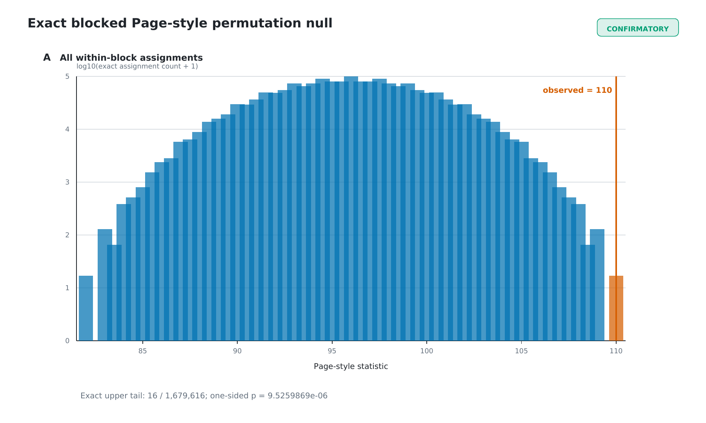
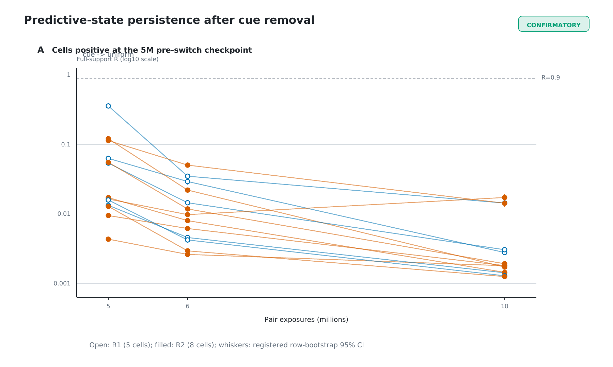
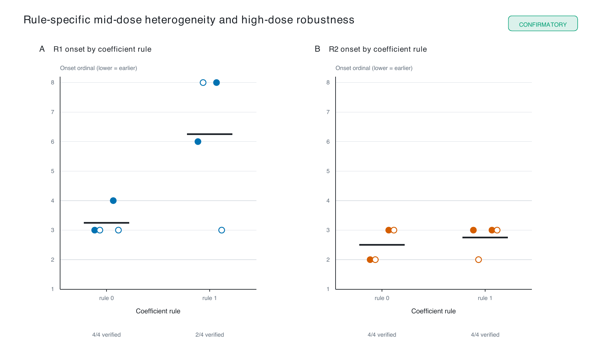
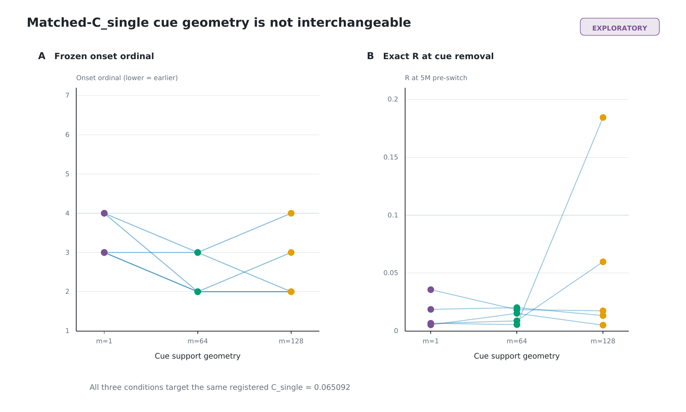

# Transient Low-Order Cues Bootstrap High-Order Compositional Representations in Transformers

## Abstract

How a model acquires a high-order predictive representation can depend on
training-distribution structure even when the target conditional, irreducible
noise, marginal entropy, and total predictable information are fixed. We
studied a controlled finite-field task in which two uniformly distributed
parents determine a modular center state and a fixed additive-noise channel
determines the target. Under uniform full support, neither parent alone carries
predictive information, although the pair jointly carries
4.66948 nats. We constructed strictly positive full-support
training distributions containing transient low-order cues while preserving
uniform marginals and the exact target conditional. An exploratory v3.5
experiment identified earlier predictive-state formation with increasing
registered cue dose. We then froze the model, optimizer, objective, evaluation,
onset definition, and test before an independent v3.6 replication using two new
coefficient rules, two new cue permutations, two initialization seeds, and
three cue doses. Across eight paired blocks, verified onset occurred in
1/8,
6/8, and
8/8 blocks for R0, R1, and R2.
The preregistered one-sided exact blocked Page-style test enumerated all
1,679,616 assignments and gave
`p = 9.525986892242037e-06`. All 13 nonzero-cue
cells positive at cue removal retained the representation threshold at 6M and
10M exposures. These results show that temporary cue-bearing full-support
distributions causally changed representation-onset timing or probability
within the frozen parent-exposed task and model family. They do not identify
singleton mutual information alone as the causal variable and do not establish
a universal Transformer property.

## Introduction

The central question is: **How does training-distribution geometry affect the
accessibility of task-sufficient representations when the final task
information is fixed?** A representation may be statistically available yet
difficult to discover because useful optimization directions are weak, cancel
across examples, or become accessible only after other features organize.
This motivates a controlled intervention that holds the target conditional
and its information budget fixed while changing the geometry of the early
training distribution.

Project Kepler isolates this question in a finite field. Earlier recurrent
experiments motivated a parent-exposed mechanism assay, but the present paper
does not claim that the recurrent production task has been solved. Instead, it
asks a narrower causal question: can a temporary low-order cue in a
full-support sampling distribution alter when a Transformer forms the
high-order predictive center state? The parent-exposed design intentionally
separates two problems: (1) identifying the relevant variables, which the
interface controls by presenting both parents directly, and (2) composing
those discovered variables into a predictive representation, which remains
the learning problem.

The experimental sequence was explicitly separated into discovery and
confirmation. Version 3.5 was exploratory and selected the cue doses and
frozen outcome definitions. Version 3.6 used new rules, new cue permutations,
new initialization seeds, and no v3.5 checkpoints. The v3.5 data are not
included in the v3.6 primary p-value. The aim is neither a new scaling law nor
a universal intelligence principle; it is a bounded causal test within one
controlled task and model family.

*Figure 1.* The parent pair determines a modular center; fixed additive noise
determines the target. Cue-bearing sampling is used only from 0--5M exposures,
after which training returns to uniform full support. All figure values are
read from frozen JSON.

## Related Work

### Grokking and delayed generalization

Modular-arithmetic grokking studies established that small neural networks can
generalize long after achieving near-perfect training performance under a
fixed training distribution ([Power et al., 2022](https://arxiv.org/abs/2201.02177)).
This paper does not offer a universal explanation of grokking. It asks a
different question: whether the geometry of the *early* training distribution,
with the final conditional and information budget held fixed, changes the
accessibility or timing of a delayed representational transition.

### Mechanistic interpretability of modular arithmetic

Mechanistic analyses of modular addition have recovered Fourier-like internal
representations and circuits implementing trigonometric structure
([Nanda et al., 2023](https://arxiv.org/abs/2301.05217)). Here, fixed-Fourier
probes are diagnostics alongside linear and fixed-capacity MLP probes. We do
not assume that a specific Fourier circuit must be learned, and the causal
result concerns the timing or probability of task-sufficient representation
formation rather than identification of a unique circuit.

### Curriculum learning

Classic curriculum learning changes example order or introduces examples and
concepts by increasing difficulty
([Bengio et al., 2009](https://icml.cc/2009/papers/119.pdf)). The present
intervention instead keeps the target conditional and Bayes information budget
fixed and changes only the geometry of the full-support training distribution
during an early window. We describe this narrower intervention as
**distributional bootstrapping of representation formation**.

### Partial Information Decomposition

Partial Information Decomposition separates redundant, unique, and synergistic
contributions in multivariate information
([Williams and Beer, 2010](https://arxiv.org/abs/1004.2515)). The full-support
base task is a pure-synergy construction in the limited operational sense
needed here: singleton information is zero while joint information is
nonzero. We do not attempt a full PID decomposition of the cue distributions
or learned representations.

## Controlled finite-field task

The field size was `p = 257`. For coefficients `a1,a2 != 0`, the predictive
center was

`z = a1*x1 + a2*x2 mod p`.

The target followed `y = z + epsilon mod p`, with
`P(epsilon=0)=1-eta`, `P(epsilon=r)=eta/(p-1)` for nonzero `r`, and
`eta = 0.1`. Consequently,
`H(Y|X1,X2) = H(nu_eta) = 0.879601 nats`, and the target
conditional was unchanged across cue conditions. The primary error metric was

`R = E_h[KL(q_h || p_theta)] / (log(p) - H(nu_eta))`.

A uniform predictor has `R=1` and the analytic oracle has `R=0`. Exact
soft-label training, exhaustive evaluation, probe definitions, and bootstrap
details are given in Supplementary Methods.

## Pure-synergy information structure

With uniformly sampled independent parents and nonzero modular coefficients,
`X1`, `X2`, `Z`, and `Y` are uniform. Each individual parent is independent of
the target: `I(Y;X1)=I(Y;X2)=0`. Jointly, however, the pair determines the
noisy center and carries
`I(Y;X1,X2)=log(p)-H(nu_eta)=4.66948 nats`.

This pure-synergy baseline makes the construction unusually clean. The
model must compose both parents to predict the center, and no marginal
frequency cue points to the answer. It also makes clear why the registered
cue index must not be described as a unique-information percentage: it is a
scalar property of the constructed sampling family, not a decomposition of
all predictive information.

## Full-support cue-family construction

The cue family reweighted ordered parent pairs through a frozen permutation
while keeping every pair probability strictly positive. Exhaustive audits
confirmed uniform `X1`, `X2`, `Z`, and `Y`, invariant `H(Y|X1,X2)`, invariant
`I(Y;X1,X2)`, and exact uniform full support at zero cue. In v3.6 the maximum
marginal-uniformity error was
`9.107e-18`
and the minimum pair probability was
`9.379e-06`.

The cue manipulation therefore changed the training distribution without
changing the target conditional or removing held-out pair support. It did not
isolate singleton mutual information from all other distributional geometry,
so the causal object is the registered cue-bearing distribution, not the
scalar index alone. Table 1 reports the frozen distribution audits; the
construction and deterministic root-solving protocol are specified in
Supplementary Methods.

## Exploratory discovery experiment

Version 3.5 used the rule `(45,36)`, five paired initialization seeds, and four
ordered `m=64` cue doses plus two matched-index geometry controls. Each run used
the same approximately 2M-parameter parent-exposed Transformer, exact
soft-label objective, and 10M-exposure schedule. Cue-bearing conditions used
their registered sampler through 5M and uniform full support thereafter.

Verified onset occurred in 0/5 C0,
5/5 C1, 5/5 C2, and
5/5 C3 seeds. The exploratory exact Page-style test
gave `p = 1.607510288065844e-05` over
`7,962,624` assignments. These data established
the frozen dose levels and transition definitions; they are discovery evidence
and were not reused as confirmatory observations.

*Figure 2.* Seed-level v3.5 R trajectories and frozen onset ordinals. Thin
lines show seeds. Bands show the mean of registered row-bootstrap interval
endpoints and are not a new group-level confidence interval.

Table 2 reports the exploratory onset and establishment outcomes.

## Independent confirmatory replication

Version 3.6 crossed two independently generated rules,
`(205,
5)` and
`(123,
209)`, with two new cue permutations
and two new initialization seeds. Within each of the eight blocks, R0, R1, and
R2 shared initial weights and every non-condition RNG/configuration field.
The targets were `C_single = 0`, `0.016`, and `0.065092`. All 24 trajectories
were stopped at 10M.

The onset counts were 1/8,
6/8, and
8/8; establishment counts by 10M
were 2/8,
6/8, and
8/8.
The primary Page-style statistic was `110.0`.
Exactly 16 of
1,679,616 within-block assignments were at least
as large, yielding one-sided
`p = 9.525986892242037e-06`. The result crossed the frozen 0.05
confirmatory threshold.

*Figure 3.* Paired terminal-coded onset ordinals for all eight new blocks.
Lines preserve rule, permutation, and initialization pairing.

*Figure 4.* Exact null distribution reconstructed from the frozen v3.6 block
ranks. The primary test contains v3.6 only.

Tables 3 and 4 report the confirmatory outcomes and the primary and stratified
exact tests. The transition and terminal-coding rules are specified in
Supplementary Methods.

Mean paired R differences at 5M pre-switch and 10M were
`-0.697162` and
`-0.321977` for R1-R0, and
`-0.259366` and
`-0.105585` for R2-R1. The adjacent
ordering was not strict in every block; the inference rests on the frozen
blocked test rather than visual curve separation.

Table 5 reports all frozen paired R differences.

## Representation persistence after cue removal

At exactly 5M, nonzero-cue runs were evaluated, only the sampler was switched
to uniform full support, and a zero-optimizer-step evaluation verified
identical model output and unchanged model, optimizer, scheduler, exposure,
and RNG state. R0 remained uniform throughout.

Five R1 and eight R2 cells were threshold-positive before the switch. All
13 remained positive at both 6M and 10M. Thus continued exposure
to the cue-bearing distribution was not required once the predictive
representation had formed. This supports learning-path preconditioning rather
than a permanently required shortcut.

*Figure 5.* Individual v3.6 threshold-positive cells at 5M, 6M, and 10M.
Whiskers are the registered first-parent-row bootstrap intervals.

Table 6 reports the cue-removal persistence audit.

## Rule and cue-geometry heterogeneity

The confirmatory ordering was significant within each coefficient rule and
within each cue permutation, but the mid-dose response was heterogeneous.
R1 onset occurred in 4/4 rule-0 blocks and
2/4 rule-1 blocks. R2 onset occurred in
4/4 and 4/4, respectively.
The high dose was therefore robust across the tested rules, whereas the
mid-dose probability or timing depended more strongly on the coefficient rule.

*Figure 6.* R1 shows rule-dependent heterogeneity; R2 forms in every tested
block. This is a bounded statement about two preregistered new rules.

The v3.5 matched-index controls further showed that equal `C_single` values
were not interchangeable. Relative to `m=64`, the concentrated `m=1`
condition changed onset ordinal by a paired mean of
`1`,
whereas the diffuse `m=128` condition changed it by
`0.2`.
This geometry sensitivity is why the manuscript does not attribute the effect
to singleton mutual information alone.

*Figure 7.* Exploratory matched-`C_single` conditions differed in onset and
intermediate R despite sharing the registered scalar index.

## Discussion

The central result is a causal property of a controlled training intervention:
temporary cue-bearing full-support distributions changed whether or when the
frozen Transformer formed a high-order modular center representation. The cue
did not change the target conditional, marginal target entropy, irreducible
noise, total pairwise predictable information, model architecture, optimizer,
or objective. Pairing initial weights and non-condition randomness made onset
timing the prespecified comparison.

The persistence result narrows the mechanism. Because threshold-positive
models retained the representation after returning to uniform full support,
the cue was not merely a predictive feature required at inference or a
permanent sampling crutch. Instead, the early distribution placed optimization
on a learning path from which the high-order representation remained useful
under the pure-synergy distribution.

At the same time, the rule and geometry results reject an overly scalar
interpretation. The registered cue index ordered selected distributions, but
equal index values could have different effects, and the R1 response varied
between coefficient rules. Distribution geometry, gradient organization, and
model state may all contribute. The present experiments identify the
registered distribution intervention as causal; they do not identify a unique
information-theoretic mediator.

### Possible mechanism: symmetry breaking and optimization accessibility

The evidence suggests a possible optimization-accessibility account:
pure synergy creates a symmetry under which singleton-aligned gradients vanish
in expectation. The parents are individually uninformative, and the symmetric
full-support average cancels their singleton-aligned gradient directions.
Transient cue distributions introduce lower-order statistical asymmetries
while preserving the target conditional and Bayes information budget. Those
asymmetries may redirect early optimization toward a state in which the two
parents can be composed; once that task-sufficient representation forms, the
cue is no longer required.

Three observations are consistent with this account: onset was ordered by
registered cue dose, threshold-positive representations persisted after cue
removal, and the frozen gradient audits showed changes in gradient coherence
around observed transitions. This is mechanistic interpretation, not a causal
mediation result. **Gradient statistics are correlates of transition dynamics,
not identified causal mediators.** The data do not establish a universal
loss-landscape mechanism or a unique circuit.

### Practical implication: distributional bootstrapping

The result suggests a possible design principle: temporary training
distributions can be used to improve access to otherwise hard-to-reach
compositional representations when the final task distribution contains
high-order dependencies. This is a hypothesis for bounded, auditable
interventions—not a claim that all AI training should use low-order cues.

## Limitations

First, model scale is limited to one approximately 2M-parameter Transformer
family; whether the effect strengthens, weakens, or changes form with scale
remains open. Second, the parent-exposed interface intentionally controls
variable identification, so recurrent context discovery and variable
selection remain future work. Third, exact soft-label training isolates
representation formation from sampled-label variance; extension to
sampled-token training remains future work. Fourth, finite-field modular
arithmetic is a controlled model organism rather than a proxy for the full
range of natural-data learning. Fifth, the experiments identify a distribution
intervention but do not establish a universal loss-landscape mechanism.

Additional design limits remain. The study uses one field size (`p=257`), one
noise level (`eta=0.1`), a finite set of cue constructions, and eight
confirmatory blocks. The checkpoint grid limits onset timing resolution, and
terminal coding cannot verify a first pass at 10M. Row-bootstrap intervals
quantify evaluation variation over parent rows, not between-rule population
uncertainty. The exact test is valid for the frozen randomization structure but
does not turn the tested rules into a population sample of all modular tasks.
The result is not a universal Transformer property, is not a thermodynamic
phase transition, does not show that the recurrent production task is solved,
and is excluded from the original scaling fit.

## Reproducibility statement

The final v3.6 commit is tagged `kepler-v3.6-confirm1`. Every manuscript number,
figure, and table is generated from frozen machine-readable JSON whose hashes
are recorded in `artifact_index.json` and
`../artifacts/v3_6_confirmatory_freeze_record.json`. The lightweight verifier
recomputes distribution invariants, onset and establishment coding, the exact
1,679,616-assignment primary test, and all paper
outputs without loading a training loop or taking an optimizer step.

Tables 7 and 8 summarize the protocol-integrity audit and claim boundaries.

## Data and code availability

Source code, frozen manifests, frozen result JSON, figure source data, table
exports, and verification scripts are contained in this repository. Raw model
checkpoints are referenced by SHA-256 sidecars and are not required for the
lightweight result-verification path. Public archival identifiers can be added
without changing the frozen scientific artifacts.

## Supplementary methods

### Task objective, evaluation, and probes

Exact soft-label cross-entropy was used throughout the parent-exposed
experiments: at each observed pair, the target was the analytic noisy
conditional rather than one sampled label. Evaluation enumerated all
`66,049` ordered parent pairs. Every checkpoint recorded exact conditional
KL, normalized R, center accuracy, center probability, predictive entropy, and
a 2,000-replicate first-parent-row bootstrap interval. Selected checkpoints
included layer-wise linear, fixed-Fourier, and fixed-capacity MLP probes.

### Cue-family construction and audit

The frozen cue permutations and coefficients reweighted the complete pair
space while preserving strictly positive probability for every pair. Lambda
was solved by deterministic root finding for each preregistered target, not
selected from model outcomes. Exhaustive enumeration verified marginal
uniformity, conditional invariance, joint information, and full support.

### Model and optimization

All paper experiments used the frozen v3.5 parent-exposed Transformer with
manifest SHA-256 `04ca572e9367ab4216ec4ff1f0528e63f6a3f7b690ae960dc214fd0e4bfadb39`. The run manifest records
2,045,568 core parameters, width
168, batch size 4,096, exact
soft-label cross-entropy, AdamW learning rate
`0.0003`, betas
`(0.9,0.95)`, weight decay
`0.1`, gradient clipping at
`1.0`, 5M warmup
exposures, and an
absolute-exposure cosine schedule. No optimizer or scheduler state was reset at
cue removal.

### Transition coding

Probe checkpoints were 2M, 3M, 4M, 5M, 6M, 7.5M, and 10M. Onset required both
the R and layer-6 linear-probe criteria at one checkpoint and their retention
at the next. Establishment was a single-checkpoint conjunction. Coding was
implemented before confirmatory outcomes were observed and was not changed.

### Exact test

Within each v3.6 block, terminal onset ordinals were converted to midranks with
earlier onset receiving higher rank. Ranks were represented as doubled
integers, preserving ties exactly. The weighted Page-style statistic used
registered condition order R0, R1, R2. All six label assignments per block
were combined across eight blocks, giving `6^8 =
1,679,616` exact assignments. The one-sided p-value
was the fraction with statistic at least as large as observed.

### Artifact integrity

The confirmatory freeze contains every Git tag, every manifest hash, v3.5 and
v3.6 result hashes, the complete environment lock, test definition and result,
and raw artifact counts. The audit validated 330 v3.5 and 264 v3.6 checkpoint
sidecars. The manuscript revision changes only files under `paper/`; prior
manifests, results, checkpoints, the confirmatory freeze record, and statistical
definitions remain unchanged.

## References

1. Power, A., Burda, Y., Edwards, H., Babuschkin, I., and Misra, V. (2022).
   “Grokking: Generalization Beyond Overfitting on Small Algorithmic
   Datasets.” [arXiv:2201.02177](https://arxiv.org/abs/2201.02177).
2. Nanda, N., Chan, L., Lieberum, T., Smith, J., and Steinhardt, J. (2023).
   “Progress Measures for Grokking via Mechanistic Interpretability.”
   [arXiv:2301.05217](https://arxiv.org/abs/2301.05217).
3. Bengio, Y., Louradour, J., Collobert, R., and Weston, J. (2009).
   “Curriculum Learning.” *Proceedings of ICML 2009*.
   [Primary paper](https://icml.cc/2009/papers/119.pdf).
4. Williams, P. L., and Beer, R. D. (2010). “Nonnegative Decomposition of
   Multivariate Information.” [arXiv:1004.2515](https://arxiv.org/abs/1004.2515).
